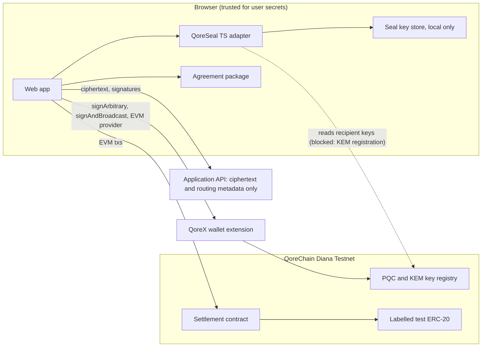

# Architecture

Status: proposed, Phase 0. Nothing here is implemented. Components marked (blocked) depend on an unverified protocol capability.

## Components

## Trust boundaries

- The server stores ciphertext, signatures and routing metadata. It never sees plaintext, seed phrases, recovery codes or private keys.
- QoreX holds the account's secp256k1 and ML-DSA-87 keys. The app asks it to sign; it never holds them.
- The ML-KEM / X25519 decryption keys are held by the app in the browser, because QoreX exposes no seal-key or decrypt method (ADR-0005).
- On-chain data is public: addresses, token transfers, timing, the agreement commitment hash.

## Signing lanes

1. Native (Cosmos) lane: transactions and `signArbitrary` messages carry a secp256k1 signature plus an ML-DSA-87 signature. The app must require the post-quantum part and verify it against the account's registered on-chain key.
2. EVM lane: transactions are ordinary ECDSA transactions. They are admitted under a hybrid-authorised EVM window that the user opens from QoreX, because the wallet refuses `MsgOpenEVMWindow` from web apps (read in the wallet-adapter source; untested against QoreX). The authorisation window scopes targets and QOR value, not ERC-20 token amounts.

## Contract state machine

To be defined in M4 before any contract code. Required decisions are listed in `docs/adr/` as they are made.
